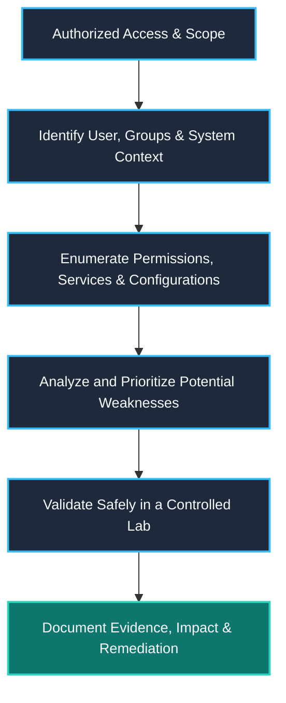

# Privilege Escalation
### Linux · Windows · Active Directory

**From Limited Access to Elevated Privileges — Through Authorized Security Testing**

---

## Overview

**Privilege escalation** is the process of obtaining permissions beyond those initially granted to an account or process. During an authorized penetration test, it helps demonstrate the impact of insecure permissions, system misconfigurations, and vulnerable software.

This section is my learning reference for **Linux, Windows, and Active Directory privilege escalation**, with emphasis on systematic enumeration, controlled validation, evidence collection, and remediation.

> **Goal:** Understand the root cause of an escalation path, demonstrate its impact safely, and explain how to prevent it.

## Assessment Workflow

---

## Study Areas

| Platform | Key concepts | Useful tools / references |
|:--|:--|:--|
| **Linux** | `sudo` rules, SUID/SGID, capabilities, cron jobs, writable files, kernel patching | `sudo`, `find`, `getcap`, linPEAS, GTFOBins |
| **Windows** | User rights, service permissions, scheduled tasks, registry ACLs, unquoted service paths, token privileges | `whoami`, `icacls`, `sc.exe`, winPEAS, AccessChk |
| **Defensive validation** | Least privilege, patch management, secure configurations, audit trails, detection opportunities | Windows Event Logs, Linux audit logs, MITRE ATT&CK |

**Note:** A suspicious setting is not automatically exploitable. Each finding needs contextual analysis and safe validation.

---

## What Each Lab Writeup Should Show

1. **Scope & environment** — authorized target, OS, and starting access level.
2. **Enumeration** — relevant commands, permissions, and observations.
3. **Root cause** — the exact misconfiguration or vulnerability.
4. **Controlled validation** — sanitized proof of impact, without exposing secrets.
5. **Detection & remediation** — relevant logs, least-privilege changes, or patches.
6. **Lessons learned** — what the exercise taught and any limitations.

---

## Lab Setup & Safety

- Use isolated VMs, intentionally vulnerable machines, or authorized TryHackMe / Hack The Box environments.
- Snapshot machines before changes and record the tested OS/version.
- Prefer low-impact checks; avoid disruptive exploits or credential exposure.
- Do not publish real passwords, tokens, private data, or live target details.

---

## Reference Material

- [MITRE ATT&CK — Privilege Escalation (TA0004)](https://attack.mitre.org/tactics/TA0004/)
- [GTFOBins — Unix binary behavior reference](https://gtfobins.github.io/)
- [LOLBAS — Windows living-off-the-land binary reference](https://lolbas-project.github.io/)
- [Microsoft Learn — Windows security documentation](https://learn.microsoft.com/windows/security/)

## Portfolio Status

This folder is a **learning and lab-documentation section**, not a claim that every technique has been mastered or every listed scenario has been completed. Individual writeups should be treated as completed only when evidence and results are provided.

## Responsible Use

**Educational and authorized testing only.** All activities must follow the scope and rules of engagement. The purpose is to understand risk and improve security—not to access systems without permission.

---

**Maintained by [Nin-Kanong (K4N0NG)](https://github.com/Nin-Kanong)**  
*Enumerate carefully · Validate responsibly · Report clearly*

[← Back to Red Team & Offensive Security](https://github.com/Nin-Kanong/Red-Team-Offensive-Security)

