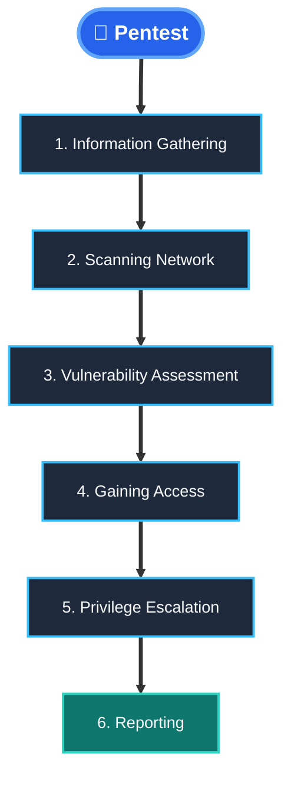

# Red Team & Offensive Security

## Nin Kanong (k4n0ng)
**Network Engineering & Security · Aspiring Penetration Tester · IT Security**

**Understand the weakness. Validate the risk. Strengthen the defense.**

[GitHub Profile](https://github.com/Nin-Kanong) · [LinkedIn](https://www.linkedin.com/in/nin-kanong/) · [Online Portfolio](https://portfolio-sandy-seven-72.vercel.app/)

---

## 👋 About Me

I'm **Nin Kanong (K4N0NG)**, an IT student at **Norton University in Phnom Penh, Cambodia**, building practical skills in **penetration testing, network security, vulnerability assessment, and security automation**.

My goal is to become a professional penetration tester, with a particular interest in securing **financial systems and digital banking services**. I'm studying toward the **Hack The Box Certified Penetration Testing Specialist (CPTS)** certification; I do **not** claim to hold the certification yet.

This repository is a learning portfolio: it contains study notes, security exercises, and lab documentation. **Topics and folders do not necessarily indicate completed assessments.**

## Explore the Repository

| Section | What you'll find |
|:--|:--|
| [1. Information Gathering](./1.%20Information_Gathering) | Passive and active reconnaissance concepts |
| [2. Network Scanning](./2.%20Scanning_Network) | Host discovery, ports, services, and network analysis |
| [3. Vulnerability Assessment](./3.%20Vulnerability%20Assessment) | Network, web, and host vulnerability assessment |
| [4. Gaining Access](./4.%20%20Gaining_Access) | Controlled exploitation and authentication-security labs |
| [5. Privilege escalation](https://github.com/Nin-Kanong/Red-Team-Offensive-Security/tree/main/5.%20Privilege_Escalation) | From normal User to Root. |
| [6. Reporting](https://github.com/Nin-Kanong/Red-Team-Offensive-Security/tree/main/6.%20Reporting) | Security findings and assessment-reporting material |

> **Portfolio status:** A mix of notes, exercises, and developing projects. Some areas are planned or being revised while I focus on further training.

> This my the hold JR Pentest: https://github.com/Nin-Kanong/TryHackMe-Labs/tree/main/02.%20Offensive%20Security/01.%20Junior%20Penetration%20Tester

---

## My Assessment Approach

For practical writeups, I aim to document the **objective, lab environment, tools, investigation steps, evidence, security impact, lessons learned, and recommended fixes**. I keep real credentials, private data, and out-of-scope targets out of public writeups.

## Related Projects & Practice

| Project | Focus |
|:--|:--|
| [TryHackMe Labs](https://github.com/Nin-Kanong/TryHackMe-Labs) | Guided cybersecurity learning paths and lab notes |
| [Capture The Flag — CTF](https://github.com/Nin-Kanong/Capture-The-Flag-CTF) | CTF exercises and problem-solving practice |
| [Google-Dorking-k4](https://github.com/Nin-Kanong/Google-Dorking-k4) | OSINT search-query tooling and research |
| [MSI-Exploit-k4](https://github.com/Nin-Kanong/MSI-Exploit-k4) | Experimental Windows security research tooling for authorized labs |

**Looking for technical evidence?** Start with the linked projects and their individual source files or writeups. I am working to make reproducible results and remediation notes easier to find.

## Technologies I Study and Use in Labs

| Area | Tools & technologies |
|:--|:--|
| Networking & analysis | TCP/IP, Nmap, Wireshark, Netcat |
| Web application security | Burp Suite, SQLMap, OWASP testing concepts |
| Security validation | Metasploit, vulnerable lab machines, CVE research |
| Authentication security | Hydra, John the Ripper, Hashcat (authorized labs) |
| Systems | Kali Linux, Ubuntu, Windows, Windows Server / Active Directory |
| Automation | Python, Bash, PowerShell; C/C++ fundamentals |
| Documentation | Markdown, technical findings, remediation guidance |

## Training & Course Certificates

These links document training and course completion; they should **not** be confused with unrelated professional certification exams.

- [SalaCyber - Network & Cybersecurity Foundation](https://github.com/user-attachments/files/23103381/1.Nin.Kanong.pdf)
- [SalaCyber - IT Security Essentials](https://github.com/user-attachments/files/23103411/2.Nin.Kanong.pdf)
- [SalaCyber - Ethical Hacking Essentials](https://github.com/user-attachments/files/23103435/3.Nin.Kanong.pdf)
- [SalaCyber - Cybersecurity Analyst & Operations](https://github.com/user-attachments/files/31230629/4.Cybersecurity.Analyst.Operation.pdf)
- [Complete Ethical Hacking Masterclass](https://github.com/user-attachments/files/23103442/1.Nin.Kanong.pdf)
- [Cisco Networking Academy - Ethical Hacker course](https://github.com/user-attachments/files/24969364/Ethical_Hacker_certificate_ninkanong200620-gmail-com_9f2ea453-5f60-4bf0-886f-bff6f3fea8a1.pdf)
- [Cisco Networking Academy - CCNA: Introduction to Networks course](https://github.com/user-attachments/files/31230603/CCNA_Introduction_to_Networks.-.Nin.Kanong.pdf)

## Current Direction

I'm developing stronger skills in **hands-on penetration testing, web security, Windows/Active Directory security, vulnerability validation, and technical reporting**. My priority is to connect each technical topic to clear evidence and practical remediation.

## Ethical Use

This repository is for **education, authorized testing, and defensive understanding**. Exercises should be performed only on systems you own or have explicit permission to assess. Do not reuse exposed secrets, test public systems without authorization, or publish sensitive third-party data.

---

**Maintained by [Nin Kanong (K4N0NG)](https://github.com/Nin-Kanong)**  
[LinkedIn](https://www.linkedin.com/in/nin-kanong/) · [GitHub](https://github.com/Nin-Kanong)

*Learn continuously · Test responsibly · Report clearly*

